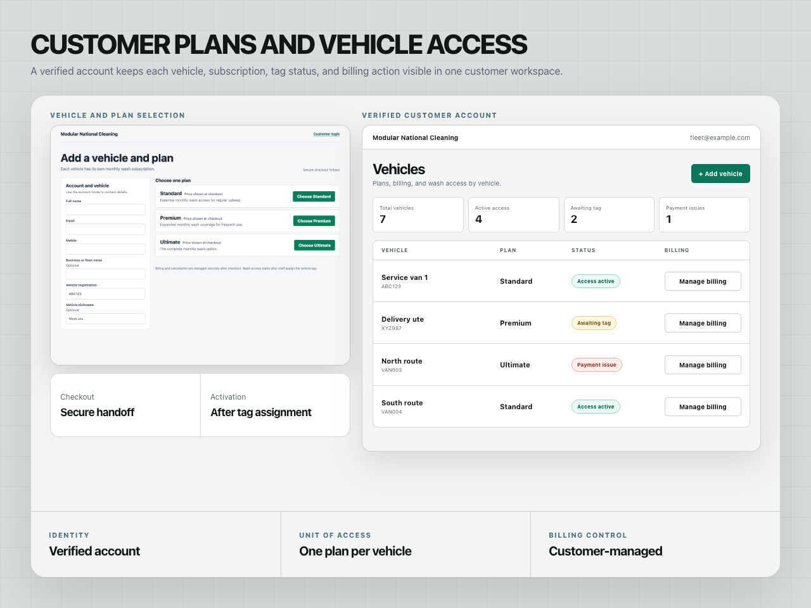
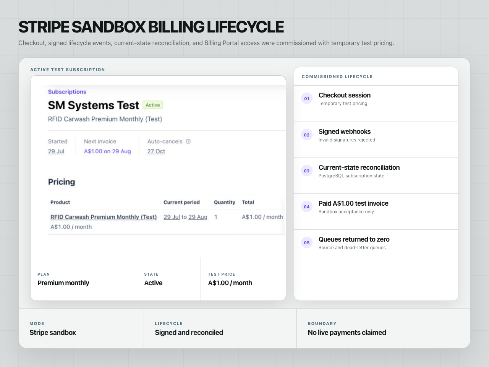
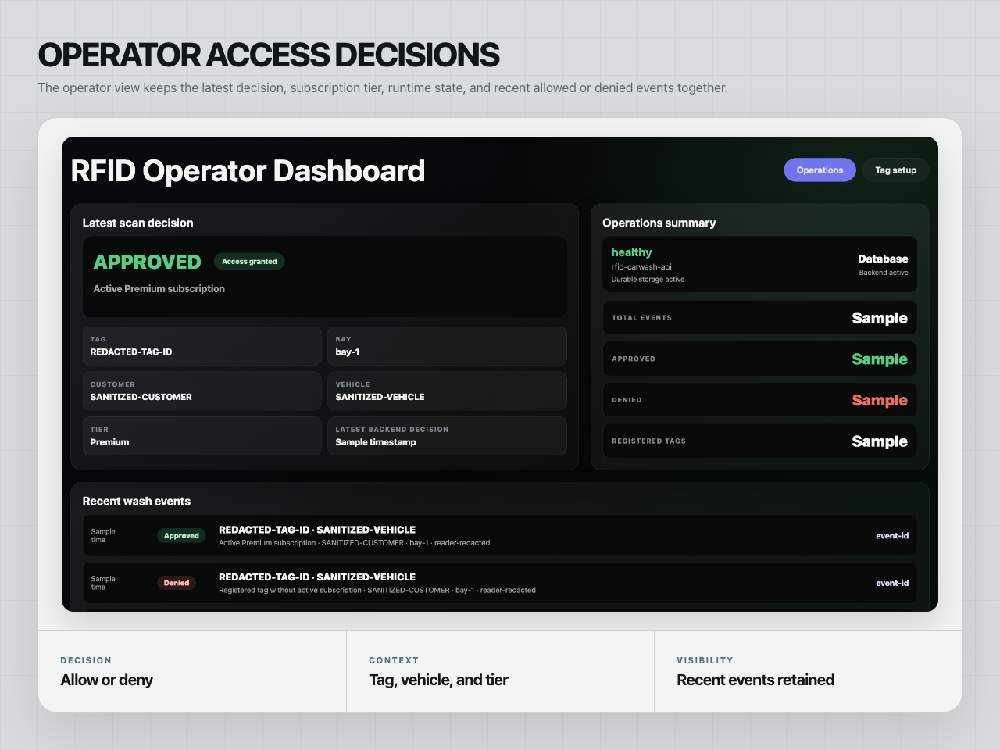
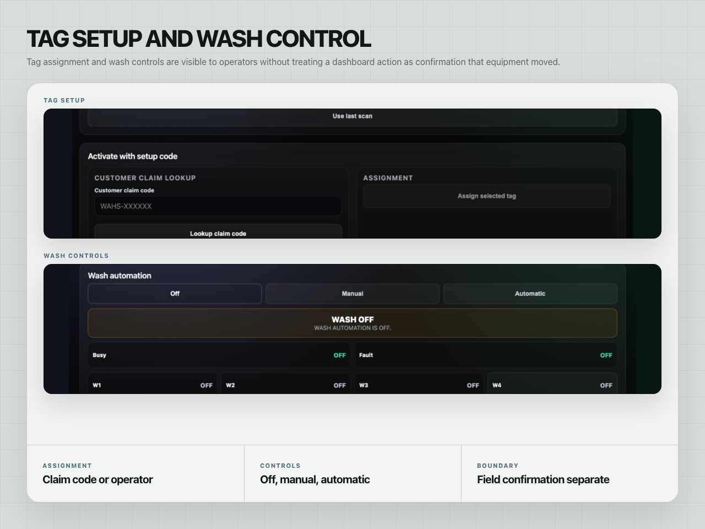
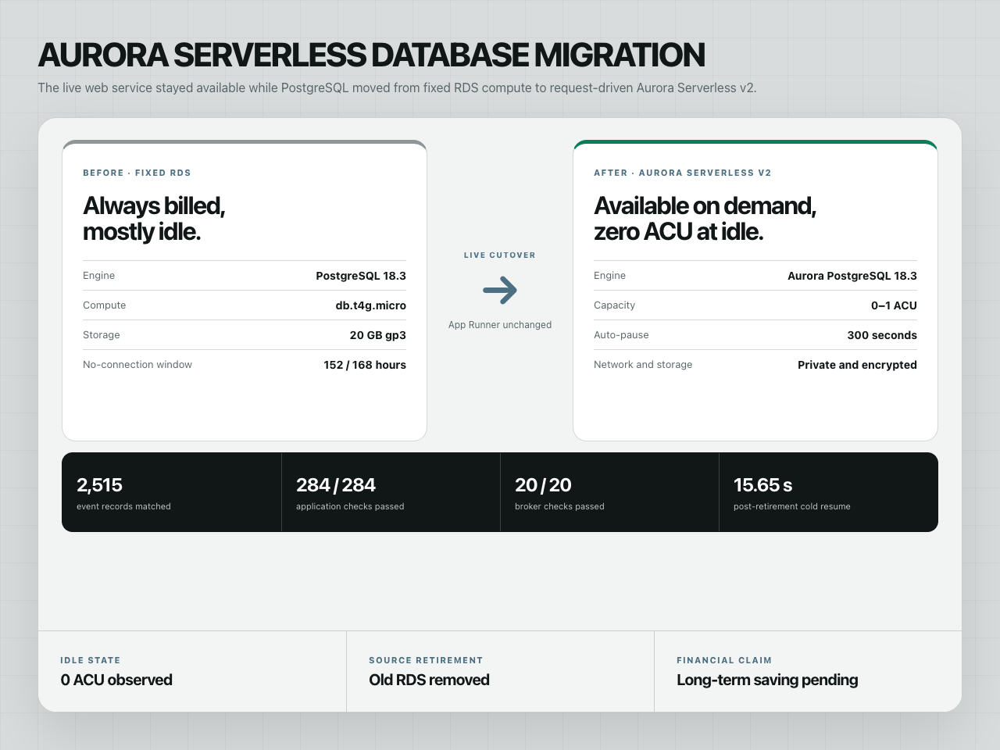

# RFID Subscription and Access Platform

A client system connecting verified customer accounts, per-vehicle subscriptions, Stripe sandbox billing, RFID entitlement decisions, operator controls, and a request-driven AWS data layer.

| | |
| --- | --- |
| Status | Client system under staged field commissioning |
| Role | Application architecture, backend, operator interface, edge integration, cloud migration, and deployment |
| Stack | .NET, ASP.NET Core, PostgreSQL, Aurora Serverless v2, AWS, Stripe, RFID, OPC UA |
| Project page | [smsystems.au/work/rfid-subscription-access-system](https://smsystems.au/work/rfid-subscription-access-system/) |

## System boundary


The system separates commercial entitlement, access decisions, and physical actuation. A customer subscription can make a registered tag eligible, but a field command remains subject to operator mode, repeat protection, equipment state, and onsite commissioning.

## Customer plans and vehicle access



The customer surface supports account verification, plan selection, checkout-session creation, per-vehicle subscription state, tag status, and customer-managed billing actions. Vehicle records remain explicit so an active plan, an unassigned tag, and a payment issue cannot be mistaken for the same operating state.

## Stripe sandbox lifecycle



Stripe sandbox Checkout and signed lifecycle events feed an ordered AWS processing path before current subscription state is reconciled into PostgreSQL. Repeated events are handled idempotently and invalid signatures are rejected.

The displayed A$1.00 subscription is temporary test pricing. This repository does not claim live payments, approved production pricing, or client revenue.

## Operator access decisions



The operator surface brings together allow-or-deny results, subscription tier, wash program, runtime status, and recent events. Stable denial reasons include unknown tag, inactive subscription, repeat lockout, busy equipment, stale decision, and unavailable field path.

## Tag setup and wash control



Tag assignment supports customer claim codes and controlled operator activation. Wash controls expose off, manual, and automatic modes with output indicators, without treating a dashboard action as confirmation that physical equipment moved.

## Aurora Serverless migration



The live application database was migrated from fixed RDS PostgreSQL to private Aurora Serverless v2. Acceptance checks preserved record counts, observed zero ACU while idle, confirmed post-retirement resume behaviour, and retired the former RDS instance. Long-term savings are not claimed.

## Access decision contract

The public contracts describe the inputs and outputs shared across the reader, edge service, API, and dashboard. They contain no client identifiers, device addresses, credentials, or live tag values.

An allowed decision includes a wash program and expiry. A denied decision carries a stable reason so customer state, safety state, and local availability remain distinguishable.

## Field commissioning boundary

The hosted application, durable records, billing-event processing, dashboard, and local edge services are implemented. Physical scanner reads, beam state, PLC/CODESYS command acknowledgement, and wash actuation remain separate field acceptance steps because cloud availability cannot establish that machinery moved.

The full operational source remains private because it contains client configuration, device addressing, and field runbooks. This repository publishes the architecture, interface contracts, controlled examples, and selected screens.

## Validate the public contracts

```bash
npm run validate
```

## Repository contents

```text
assets/       six public-safe system frames
contracts/    access-decision and event schemas
examples/     controlled allowed and denied decisions
scripts/      structural validator
docs/         architecture and operating boundaries
```

[Architecture and failure boundaries](docs/architecture.md)
