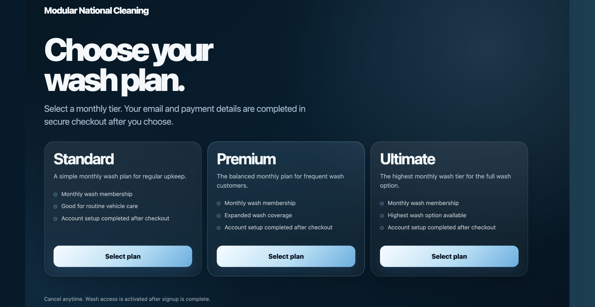
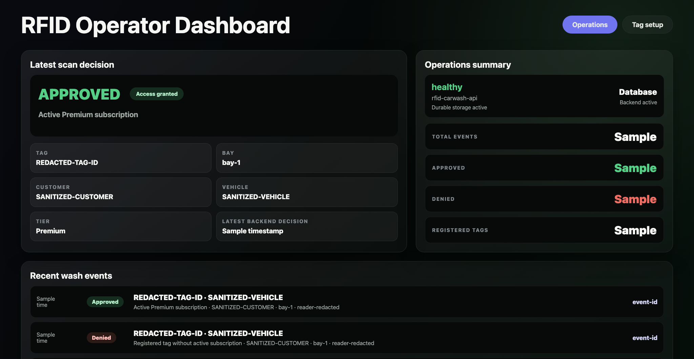
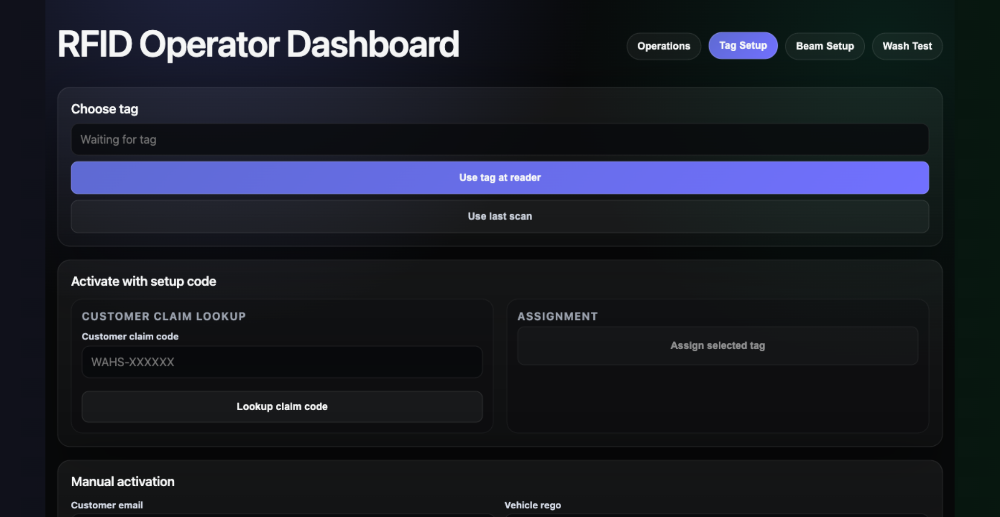
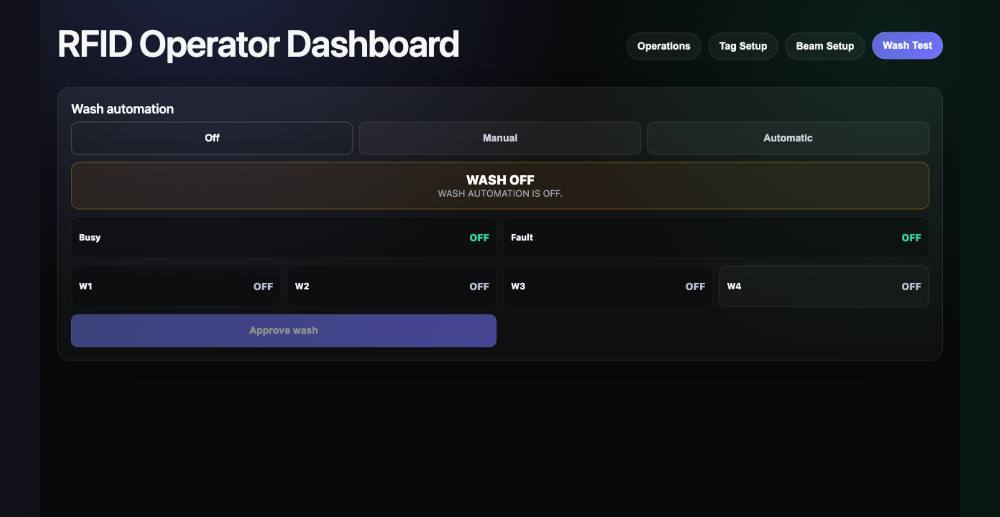

# RFID Carwash Subscription Access System

A subscription and vehicle-access platform connecting customer plans, account management, RFID tag registration, access decisions and operator controls.

| | |
| --- | --- |
| Status | Client system under staged field commissioning |
| Role | Application architecture, backend, operator interface, edge integration and deployment |
| Stack | .NET, ASP.NET Core, PostgreSQL, AWS, Stripe, RFID, OPC UA |
| Project page | [smsystems.au/work/rfid-subscription-access-system](https://smsystems.au/work/rfid-subscription-access-system/) |

## System boundary

```text
customer plan and account
           │
           ▼
subscription state ─────► tag claim and registration
                                  │
RFID reader ─► edge service ──────┤
                                  ▼
                         access decision API
                                  │
                      ┌───────────┴───────────┐
                      ▼                       ▼
              operator dashboard       PLC command path
```

The software separates commercial entitlement from physical actuation. A tag read can produce an access decision only when the tag, subscription and local safety state are consistent. The command path remains subject to operator mode, repeat protection, busy state and site commissioning.

## Customer and subscription flow

The customer surface supports plan selection, account setup, checkout-session creation, subscription state and tag claim. Stripe webhook events are stored idempotently so a repeated event does not advance the account twice.



## Operator controls

The operator dashboard brings together recent decisions, wash tiers, runtime status, tag setup and controlled wash testing.



Tag assignment supports customer claim codes and manual operator activation. The registration record keeps the tag, vehicle and subscription relationship explicit.



Wash Test exposes the selected automation mode and output indicators without treating a dashboard action as confirmation of a physical wash.



## Access decision contract

The public contracts describe the inputs and outputs shared across the reader, edge service, API and dashboard. They contain no client identifiers, device addresses, credentials or live tag values.

An allowed decision includes a wash program and expiry. A denied decision carries a stable reason such as unknown tag, inactive subscription, repeat lockout, system busy or field path unavailable.

## Field commissioning boundary

The hosted application, database-backed records, dashboard and local edge services are implemented. Physical scanner reads, beam state, PLC/CODESYS command acknowledgement and wash actuation are verified as separate field steps because cloud availability alone cannot establish that machinery moved.

The full operational source remains private due to client configuration, device addressing and field runbooks. This repository publishes the architecture, interface contracts and selected screens.

## Validate the public contracts

```bash
npm run validate
```

## Repository contents

```text
assets/       customer and operator screens
contracts/    access-decision and event schemas
examples/     controlled allowed and denied decisions
scripts/      structural validator
docs/         architecture and commissioning boundaries
```

[Architecture and failure boundaries](docs/architecture.md)
