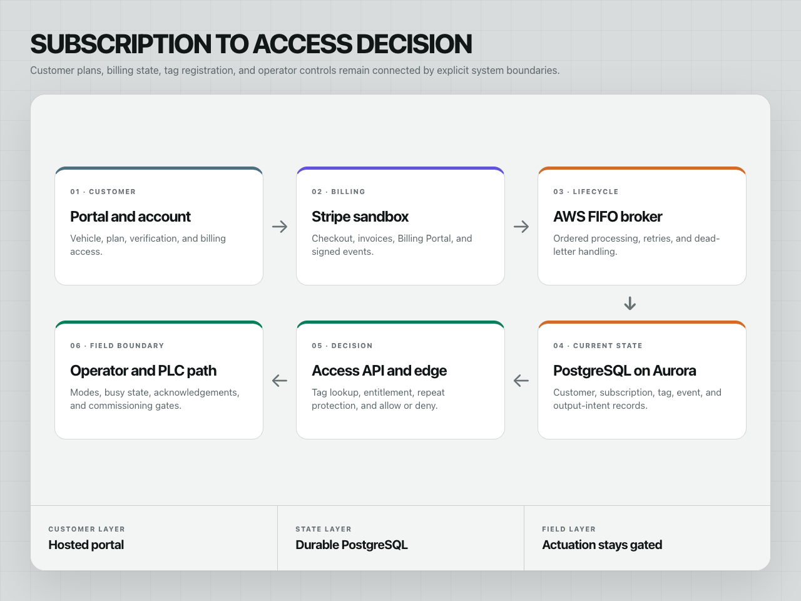
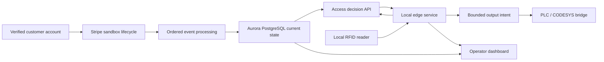
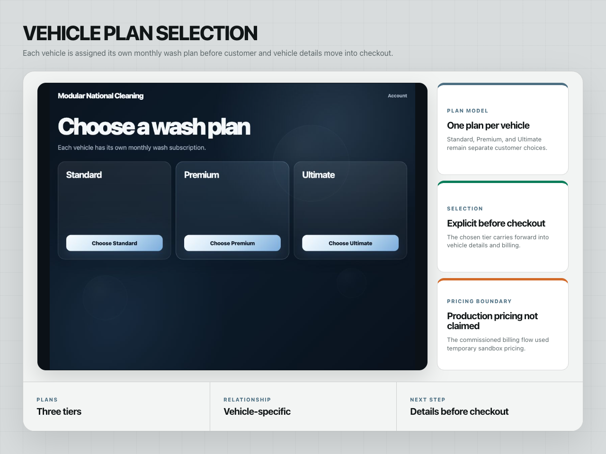
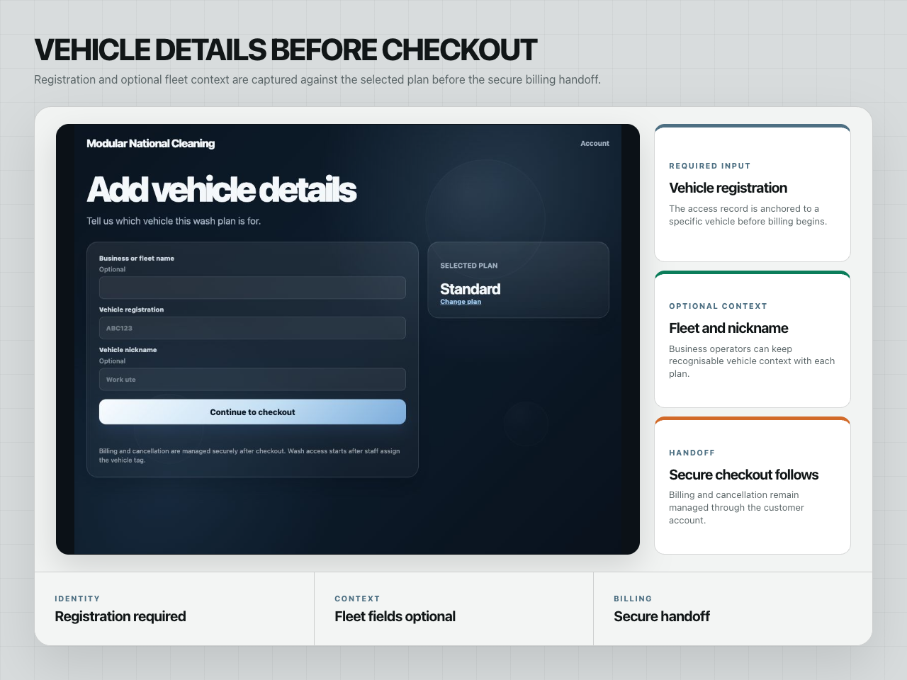
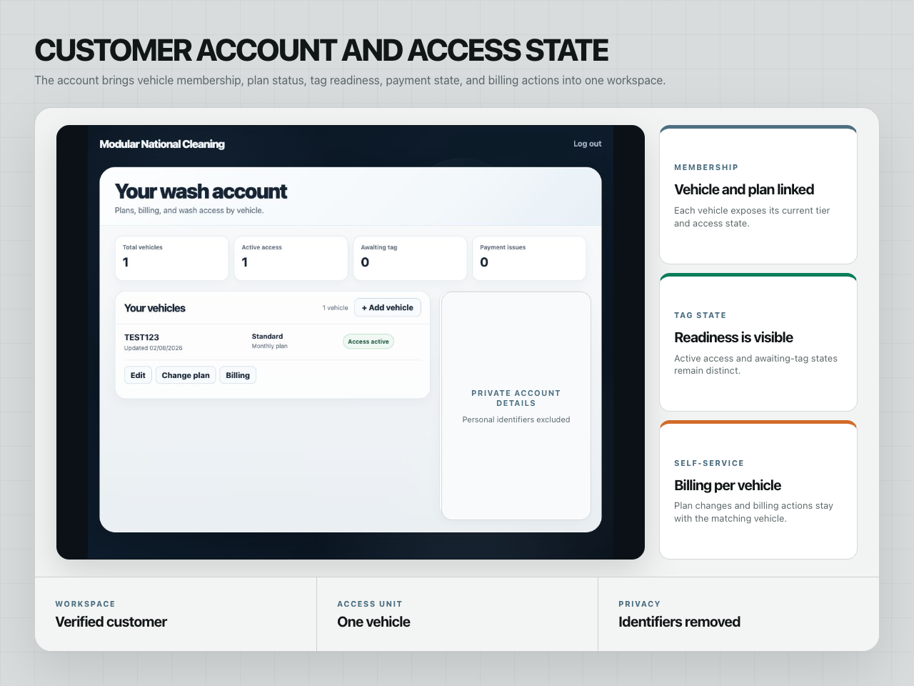
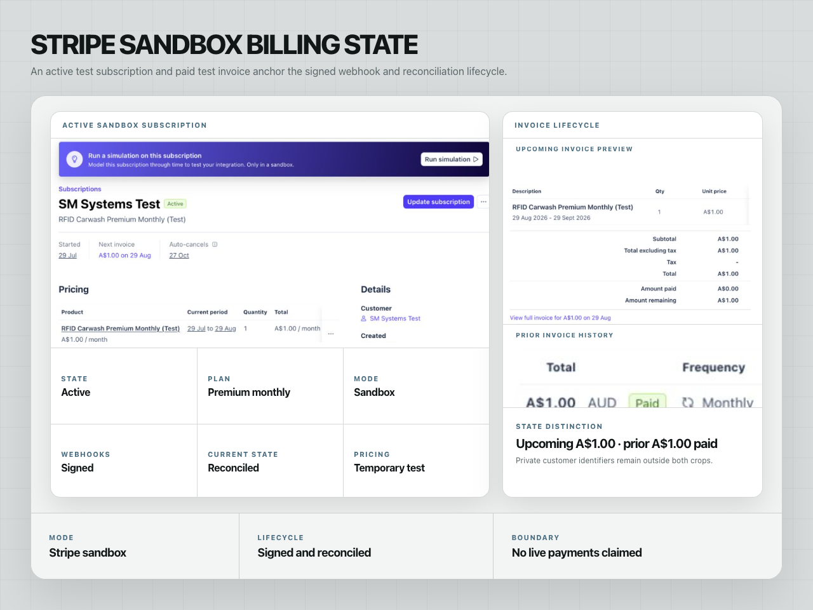
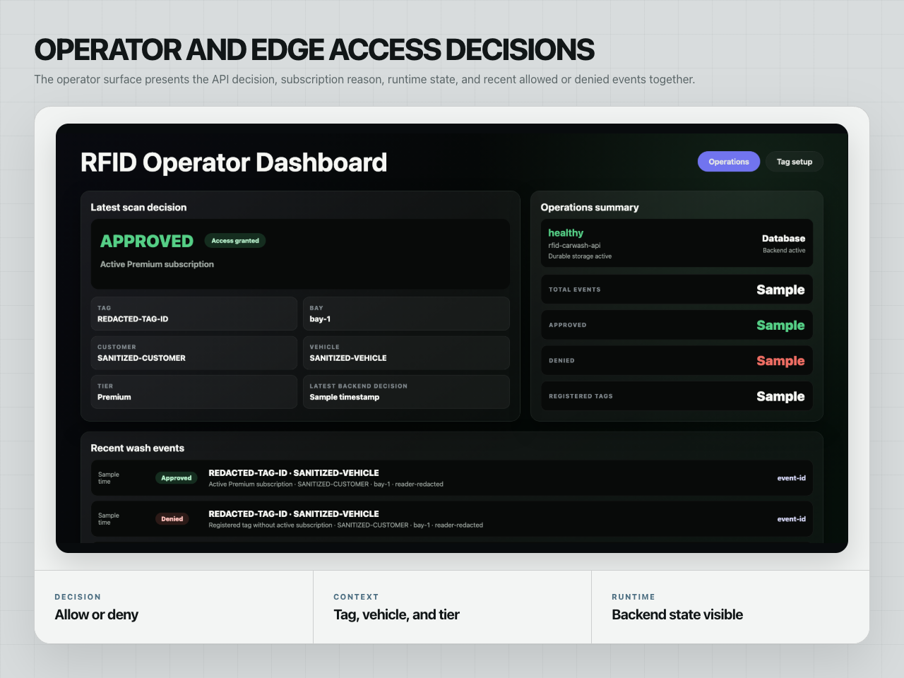
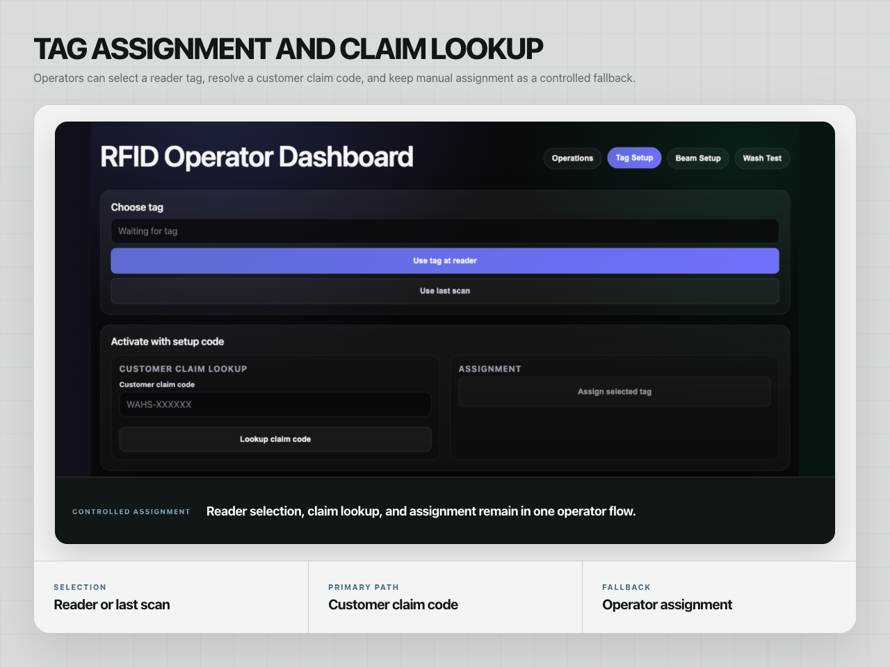
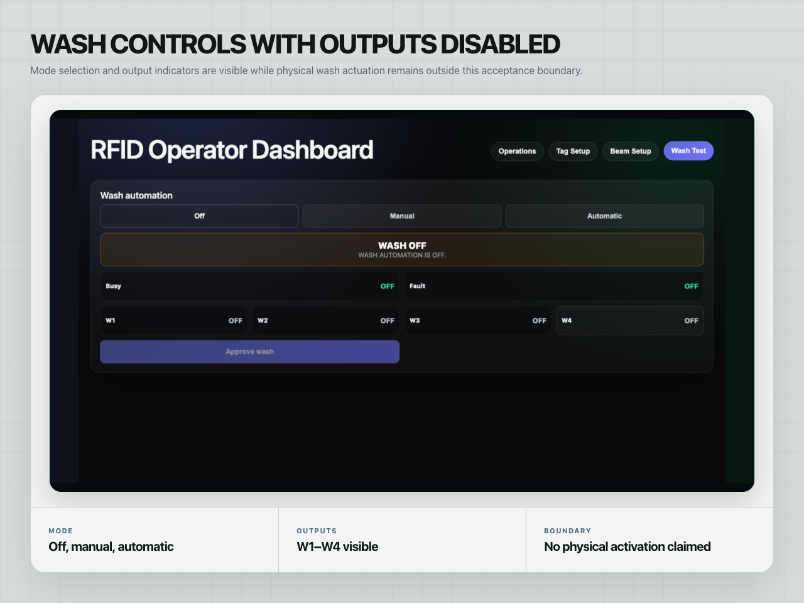
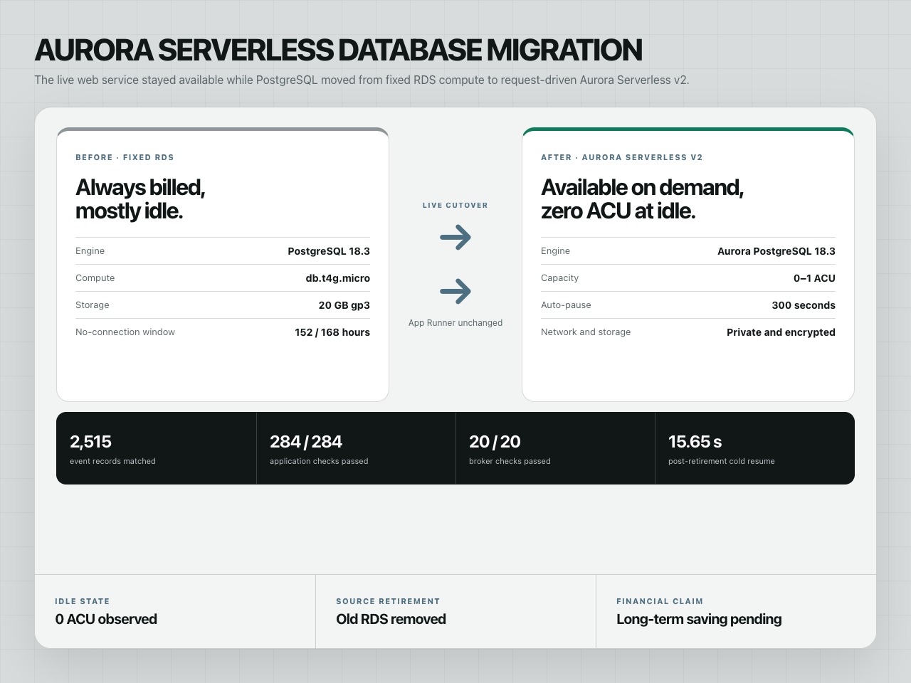

# RFID Subscription and Access Platform

One connected system carries a customer from verified account and per-vehicle subscription state to a deterministic RFID allow-or-deny decision, while keeping every equipment command behind a separate local safety boundary.

| | |
| --- | --- |
| Delivery state | Hosted application and local edge path implemented; staged field commissioning remains |
| Role | Application architecture, backend, customer portal, operator interface, edge integration, cloud migration, and deployment |
| Stack | .NET 10, ASP.NET Core, PostgreSQL, Aurora Serverless v2, AWS, Stripe sandbox, SQLite, RFID, OPC UA |
| Public case study | [smsystems.au/work/rfid-subscription-access-system](https://smsystems.au/work/rfid-subscription-access-system/) |

## The operating result

The platform gives each layer one job:

- **Customer account:** verified identity, plan selection, vehicle registration, subscription status, tag status, and customer-owned billing access.
- **Commercial state:** signed lifecycle events are ordered, deduplicated, and reconciled into durable per-vehicle state.
- **Access decision:** a tag read returns a short-lived, reason-coded allow or deny result.
- **Local control:** the edge service retains a SQLite-backed snapshot and outbox, repeat protection, and a bounded output-intent path.
- **Operator view:** customer context, access decisions, tag setup, runtime health, and wash modes remain observable without implying physical movement.

The system deliberately does **not** collapse an active subscription, an eligible access decision, a requested output, and confirmed equipment actuation into one status.

## System boundary





Commercial eligibility can make a registered tag eligible. A physical command still requires a current decision, the correct operator mode, an available local path, repeat and busy-state gates, and separate field commissioning.

## Customer account and subscription state



The customer starts with a plan selected for one vehicle rather than a detached subscription product.



Vehicle details are bound before the provider handoff, keeping the commercial record attached to the asset that will receive a tag.



The account surface keeps plan, vehicle, subscription, tag, and payment states explicit. That prevents an active plan, an unassigned tag, and a payment issue from being presented as the same condition. Billing actions are initiated only from an authenticated account and resolve the provider customer server-side.

[Customer identity and account boundary](docs/customer-account-security.md)

## Ordered billing reconciliation



Signed provider events enter an ordered processing path before current state changes. Duplicate delivery is a no-op, older sequence values cannot move the projection backwards, and invalid signatures never enter the state transition path.

The displayed A$1.00 subscription is temporary sandbox pricing. This repository does not claim live payments, approved production pricing, client revenue, or commercial savings.

[Subscription reconciliation](docs/subscription-reconciliation.md)

## Deterministic access and operator controls



The operator surface brings together allow-or-deny results, subscription tier, wash program, runtime status, and recent events. Stable denial reasons distinguish an unknown tag, inactive subscription, repeat lockout, busy controller, stale decision, and unavailable field path.



Tag assignment supports customer claim codes and controlled operator activation.



Off, manual, and automatic modes remain separate from the output-intent state, and an intent remains separate from command acknowledgement.

[Local edge and outbox](docs/local-edge-and-outbox.md) · [Field safety and commissioning](docs/field-safety-and-commissioning.md)

## Request-driven AWS data layer



The hosted PostgreSQL workload moved from fixed RDS compute to private Aurora Serverless v2. Acceptance checks covered record-count parity, application read and write paths, backup creation, observed zero-ACU idle state, post-retirement resume behaviour, and retirement of the former instance. These checks establish migration and runtime behaviour; they do not establish long-term savings.

[Aurora migration](docs/aurora-migration.md)

## Reliability controls

| Risk | Control | Observable result |
| --- | --- | --- |
| Duplicate provider event | Provider event ID plus ordered projection | Duplicate does not advance current state |
| Out-of-order lifecycle event | Monotonic sequence gate | Older event cannot overwrite a newer state |
| Unknown or inactive tag | Fail-closed access decision | Stable denial reason; no wash program |
| Repeated tag read | Per-tag lockout window | Repeat decision is denied |
| Partial edge connectivity | Full versioned tag snapshot plus local outbox | Local state is explicit; pending delivery remains visible |
| Duplicate local delivery | Stable message ID and acknowledgement state | Repeated enqueue or acknowledgement is a no-op |
| Uncommissioned field path | Dry-run output intent | Intent is recorded but actuation is not permitted |
| Busy or unavailable controller | Local command gate | Commercial eligibility does not bypass field state |

## Public contracts and synthetic fixtures

Seven JSON Schemas describe the public interfaces without client identifiers, network addresses, credentials, payment IDs, or live tag values:

- [Access decision](contracts/access-decision.json)
- [Wash event](contracts/wash-event.json)
- [RFID read](contracts/rfid-read.schema.json)
- [Subscription state change](contracts/subscription-state-change.schema.json)
- [Full tag snapshot](contracts/tag-snapshot.schema.json)
- [Local outbox message](contracts/local-outbox.schema.json)
- [Output intent](contracts/output-intent.schema.json)

Every file under [`examples/`](examples/) is marked `synthetic` and is validated against its declared schema.

## Executable .NET 10 reference model

The small model under [`src/Rfid.ReferenceModel/`](src/Rfid.ReferenceModel/) makes the most important controls executable:

```bash
dotnet run --project src/Rfid.ReferenceModel/Rfid.ReferenceModel.csproj
dotnet test Rfid.SubscriptionAccess.Reference.slnx
```

The tests cover:

- fail-closed decisions, entitlement expiry, and stable denial reasons;
- repeat-read lockout;
- ordered, idempotent subscription projection;
- atomic full-snapshot replacement;
- acknowledgement-safe local outbox behaviour; and
- dry-run versus commissioned output intent.

This is a public reference model, not a copy of private client source or field configuration.

## Validate the repository

```bash
npm ci
npm run validate
npm run validate:dotnet
```

The Node validator compiles every schema, validates every synthetic fixture, verifies the PNG [integrity manifest](assets/manifest.json), resolves local Markdown links, checks the machine-readable [claim matrix](verification/claim-matrix.json), and rejects common secret/private-data patterns. CI runs the Node and .NET paths independently.

## Repository map

```text
assets/       public-safe system frames and integrity manifest
contracts/    provider-neutral JSON Schemas
docs/         architecture, security, operations, migration, and verification notes
examples/     synthetic contract fixtures
verification/ machine-readable claim status and basis
scripts/      repository validator
src/          executable .NET 10 reference model
tests/        behavioural tests for the critical controls
```

## Detailed case study

- [System case study](docs/case-study.md)
- [Architecture and failure boundaries](docs/architecture.md)
- [Customer account security](docs/customer-account-security.md)
- [Subscription reconciliation](docs/subscription-reconciliation.md)
- [Local edge and outbox](docs/local-edge-and-outbox.md)
- [Field safety and commissioning](docs/field-safety-and-commissioning.md)
- [Aurora migration](docs/aurora-migration.md)
- [Verification matrix](docs/verification-matrix.md)
- [Publication boundary](docs/publication-boundary.md)

## Delivery boundary

The hosted application, durable records, sandbox billing-event path, operator dashboard, local edge services, and output-intent controls are implemented. Physical scanner reads, beam state, PLC/CODESYS acknowledgement, and wash actuation remain separate onsite acceptance steps.

The operational repository remains private because it contains client configuration, provider setup, device addressing, and field runbooks. This repository publishes architecture, contracts, synthetic fixtures, a reference implementation, behavioural tests, and selected screens only.
