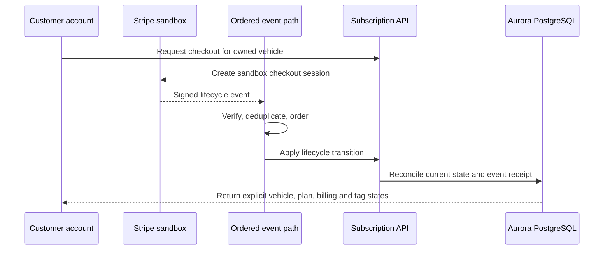
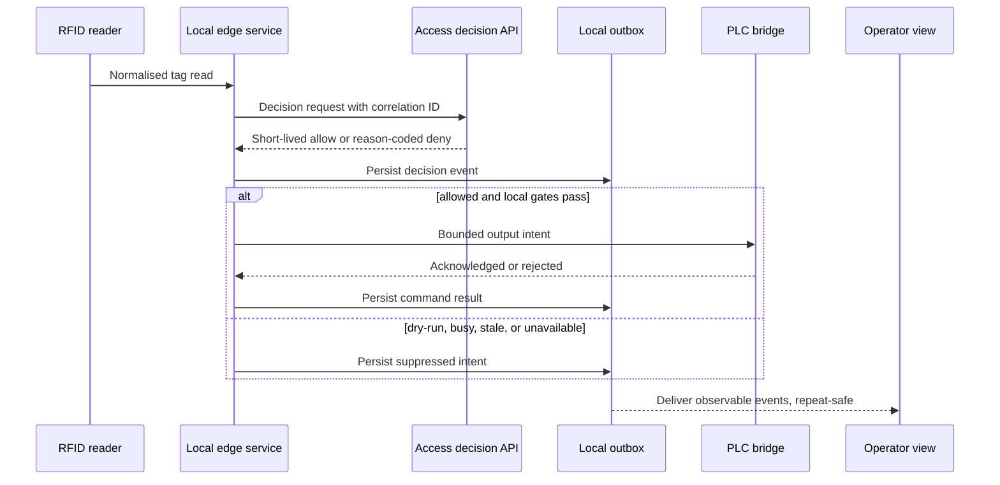

# Architecture and failure boundaries

## Design rule

Subscription state, access eligibility, output intent, command acknowledgement, and observed equipment state are separate records. Each transition has its own owner and failure mode.

## Components

| Component | Responsibility | Does not establish |
| --- | --- | --- |
| Customer web | Account verification, plan selection, per-vehicle state, checkout initiation, Billing Portal entry | Payment success without provider reconciliation |
| Stripe sandbox | Temporary Checkout, invoice, subscription, and signed lifecycle events | Approved pricing or live revenue |
| Ordered event path | Signature-gated, duplicate-resistant subscription processing | Local field availability |
| Subscription API | Account, subscription, claim-code, billing-event, and webhook state | Physical machine state |
| Aurora PostgreSQL | Durable customer, subscription, tag, event, decision, and intent records | Local command acknowledgement |
| Access decision API | Tag lookup, entitlement checks, repeat protection, and short-lived decisions | Equipment movement |
| Edge service | Reader normalisation, local snapshot, decision requests, lockout, and outbox | Customer billing ownership |
| PLC bridge | Bounded command and acknowledgement interface | Commercial entitlement |
| Operator dashboard | Runtime, tag management, decisions, events, modes, and output-intent visibility | Direct confirmation of wash completion |

## Commercial state sequence

Provider event receipt and current state are separate. A repeated event can be acknowledged without applying the transition twice. An older sequence cannot overwrite a newer projection.

## Access and command sequence

## Fail-closed outcomes

- no current full snapshot;
- unknown or unassigned tag;
- inactive or unresolved subscription;
- repeated read inside the lockout interval;
- busy controller or active command;
- expired decision;
- unavailable local dependency; or
- field path not commissioned for the selected mode.

## Local-first boundary

Customer and operator application state can run in AWS. Reader timing, the local entitlement snapshot, repeat protection, intent persistence, and the controller bridge stay local to the site. Loss of a cloud connection must not turn into an implicit allow, while loss of upstream event delivery must not erase the local event.

## Related detail

- [Subscription reconciliation](subscription-reconciliation.md)
- [Local edge and outbox](local-edge-and-outbox.md)
- [Field safety and commissioning](field-safety-and-commissioning.md)
- [Publication boundary](publication-boundary.md)
