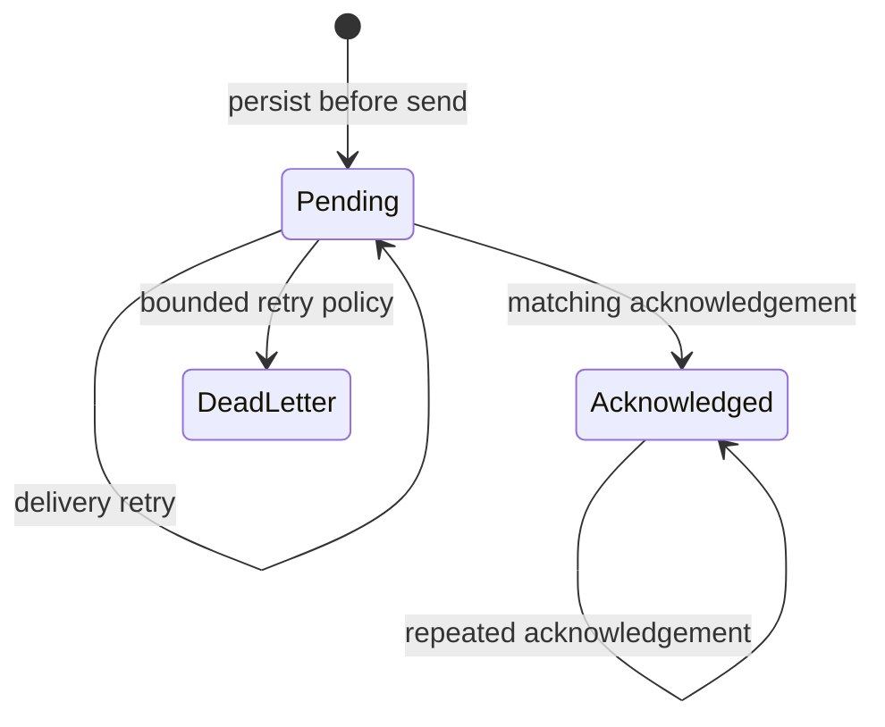

# Local-first edge and outbox

## Why the field path stays local

RFID reader timing and controller acknowledgement cannot depend on a public cloud round trip. The hosted API owns durable commercial and operational records; the local edge uses SQLite for the current entitlement snapshot and outbox, and owns reader normalisation, repeat protection, intent persistence, and the PLC bridge.

## Full tag snapshot

The edge accepts a complete, versioned snapshot rather than relying only on incremental tag changes.

Acceptance rules:

- the new version must be greater than the current version;
- every tag ID in the incoming snapshot must be unique;
- the complete snapshot is validated before state changes;
- the replacement is atomic; and
- a tag omitted from the accepted snapshot is removed locally.

The public [`TagSnapshotStore`](../src/Rfid.ReferenceModel/TagSnapshotStore.cs) demonstrates these semantics.

## Read-to-decision path

1. The reader adapter emits a normalised tag ID, timestamp, correlation ID, and monotonic sequence.
2. The edge checks that a current snapshot and field path are available.
3. The access decision evaluates tag assignment, subscription state and expiry, busy state, and repeat lockout.
4. A short-lived allow response includes a wash program; a deny response includes a stable reason.
5. The decision is persisted locally before upstream delivery.
6. Only an allowed, unexpired result can enter output-intent planning.

## Local outbox

Every outbound local event has a stable message ID, aggregate reference, sequence, payload digest, creation time, delivery-attempt count, and acknowledgement state.

The message remains pending across a network interruption. Re-enqueueing the same ID does not duplicate it, and acknowledging an already acknowledged message does not regress state.

## Offline boundary

Local state supports deterministic fail-closed decisions and durable event capture. It does not create a permanent offline commercial authority. Snapshot freshness, commissioning mode, and policy determine whether an offline path can do anything beyond record a denied or dry-run result.
